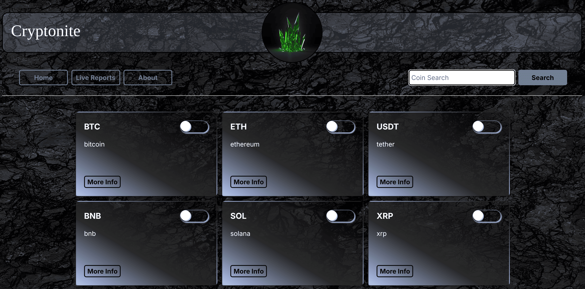
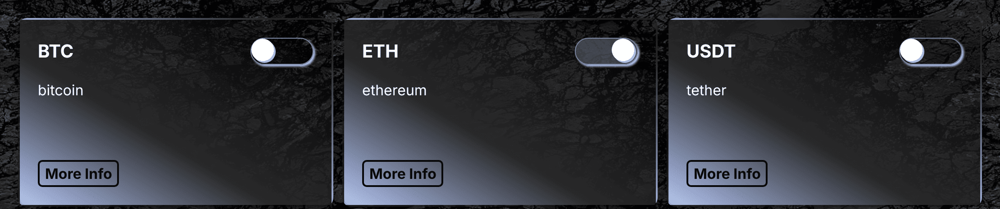
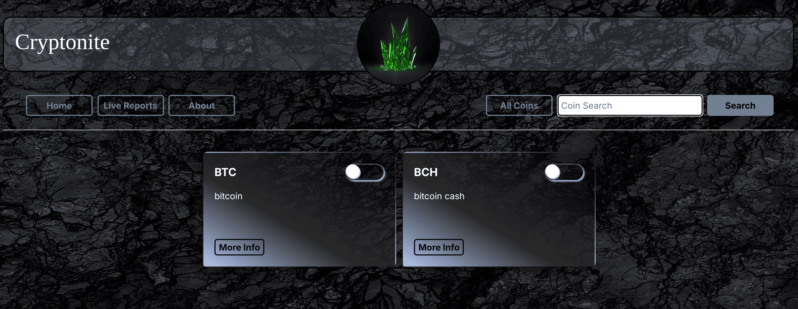
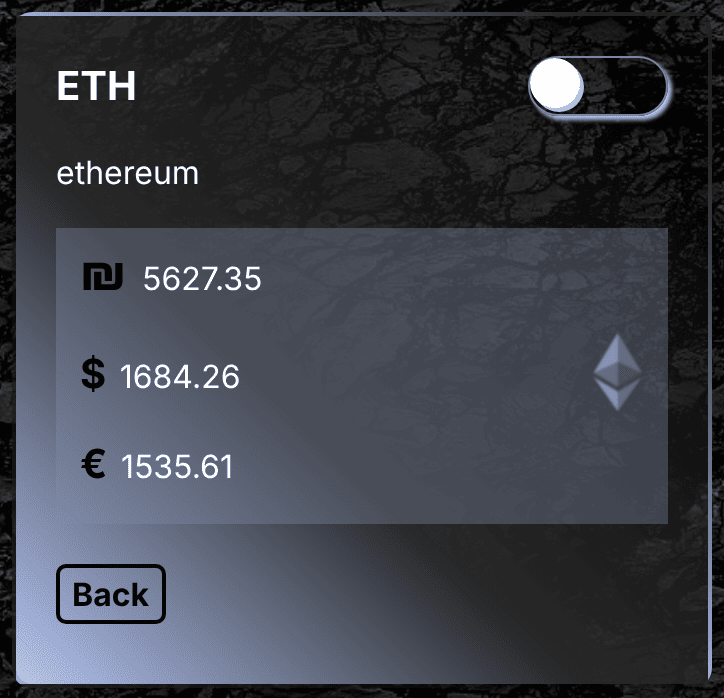
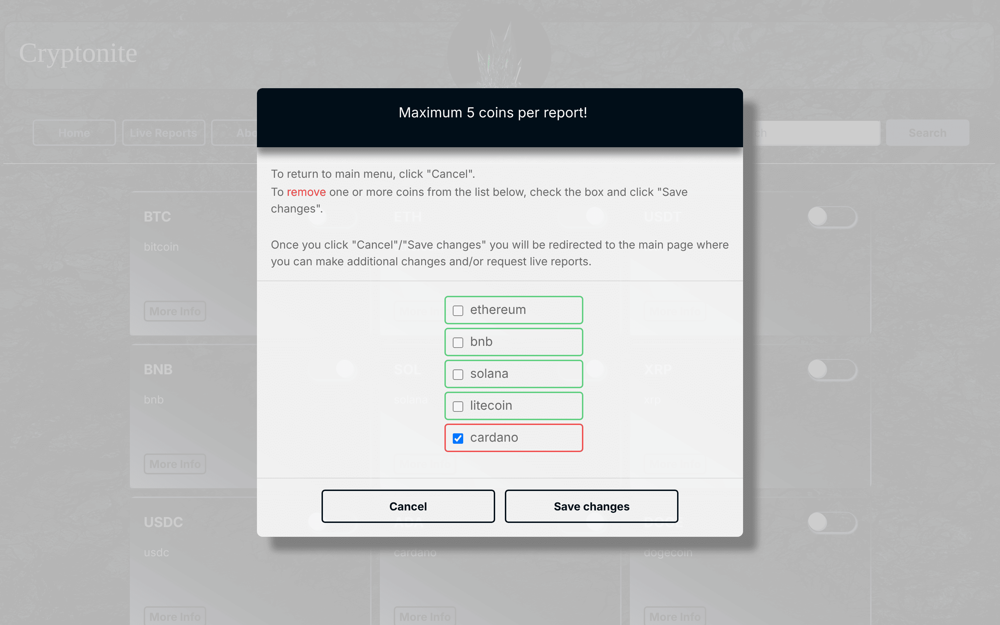
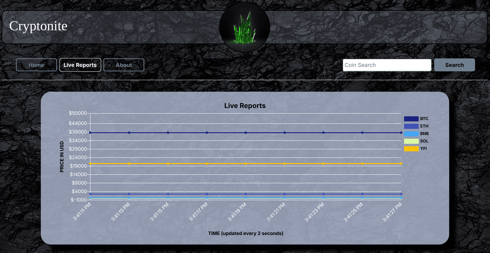
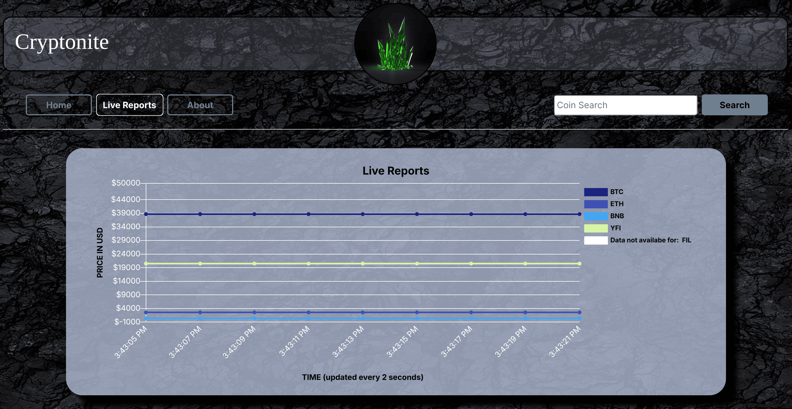
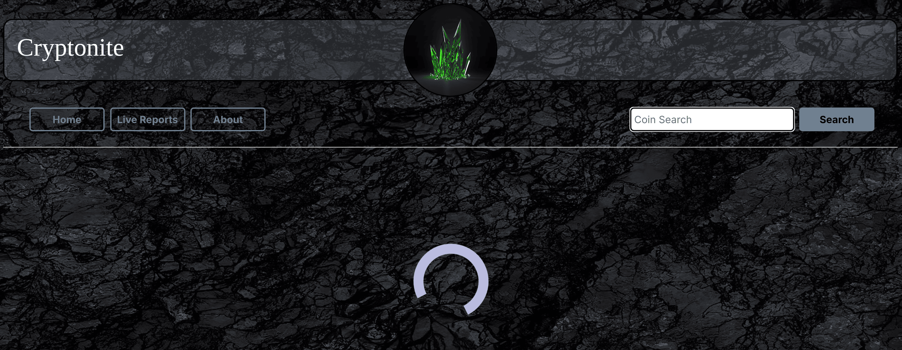
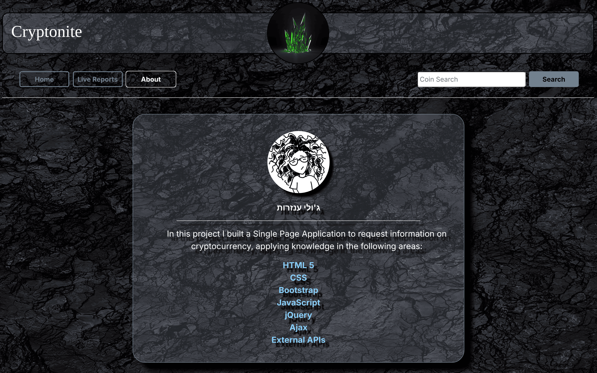

# Cryptonite

A single-page app for browsing cryptocurrency info, built with HTML, CSS, Bootstrap, JavaScript, jQuery and Ajax using external APIs (CoinGecko and CryptoCompare). Custom styling throughout: a stone-textured theme, glass-style coin cards, toggle switches and a CSS loading animation.

> Note: the CryptoCompare API used for Live Reports now requires an API key, so that feature no longer works on the live site. Chart screenshots use sample prices.

## Screenshots

### Home

### Select coins for live reports
Each card has a toggle switch for adding the coin to a live report.

### Search
Search by coin name or symbol. Searching "bitcoin" filters the list to Bitcoin and Bitcoin Cash; "All Coins" returns to the full list.

### More info
The coin's logo and current price in shekels, dollars and euros, cached for 2 minutes to avoid extra API calls.

### Maximum 5 coins per report
Selecting a 6th coin opens a pop-up for choosing which coins to remove.

### Live reports
Compares up to 5 coins' prices in USD, updated every 2 seconds.

If a selected coin has no price data, the chart says so:

### Loading animation

### About

